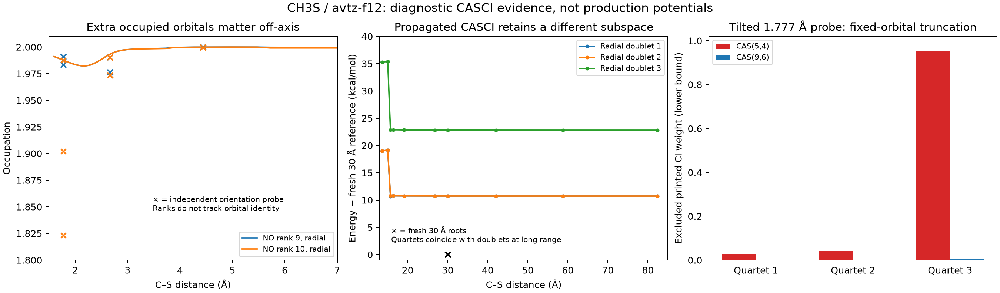

# CH3S TZ-F12 orbital review — 15 October 2026

**Recommendation:** test the chemically motivated CAS(5,4) against CAS(9,6)
and the larger diagnostic CAS(13,8), with optimized orbitals and physically
appropriate state averages. The frozen-orbital reconnaissance does not establish
which is the best production space, or restrict CAS(5,4) to the outer region.
Resolve the initialization discrepancy below before interpreting its occupation
and CI-weight warnings as evidence for enlarging the production space.
No production state-model file has been created or approved.

## Literature basis and limits

This reconnaissance combines established multireference diagnostics with a
**custom screening workflow**. It is not a published VRC-TST algorithm for
determining the best CAS. [AVAS](https://arxiv.org/abs/1701.07862) constructs
candidate spaces from selected atomic valence orbitals;
[Molpro](https://www.molpro.net/manual/doku.php?id=automated_construction_of_atomic_valence_active_spaces)
documents CASCI natural-occupation inspection to help refine that selection.
Neither establishes a production interaction-energy or rate error from an
occupation cutoff alone.

In [Klippenstein, Mulvihill and Glarborg's NH2O study, section 2.2](https://backend.orbit.dtu.dk/ws/portalfiles/portal/337661919/nh2_o_revised_final.pdf),
NH2 + O uses CAS(5,4), containing the NH2 radical orbital and all three O p
orbitals. The inner calculation uses a two-state average and the outer a
three-state average. NH + OH uses CAS(3,3) inside and CAS(5,4) outside, including
the additional OH component outside. Inner reactive flux and outer electronic
contributions are treated separately under stated dynamical assumptions.
The paper does not prescribe this recon's common six-root diagnostic average.

For CH3 + S, the analogous radical orbital plus the complete S 3p shell gives
a chemically motivated CAS(5,4) baseline. This is a chemical inference, not a
validation of transfer from oxygen to sulfur. CAS(9,6) and CAS(13,8) provide
comparison spaces; their larger size alone does not establish better production
results. Select the required surfaces and averages for each channel and region,
optimize and track the intended orbital subspaces, then test correlated
interaction energies, relevant spin splittings and rate sensitivity.

The numerical refinement thresholds, midpoint insertions and 115 Å extension
are implementation heuristics, not literature criteria for CAS adequacy.
Initialization can masquerade as poor spatial coverage: a separate
[VRC-TST study](https://pmc.ncbi.nlm.nih.gov/articles/PMC12573747/), section 3,
reports incorrect active-space convergence and multiple apparent asymptotes
for vinoxy + ethyl, corrected by a more careful wavefunction guess strategy.
That example supports checking initialization; it does not diagnose CH3S by
itself.

## Evidence and reproducibility

The user supplied `ch3s_tzf12_review_coz08qx7.tar.gz`, containing 65 completed
avtz-f12 probes: 53 radial and 12 orientation probes. The review verified
**325 SHA-256 fingerprints**: each prepared input, native input, native output,
and both orbital XML exports. WFU files remain on Blodgett; their recorded
hashes and source paths are retained but their bytes cannot be reverified
from this archive. Native output confirms CASCI, with no orbital optimization.

The reproducible [analyzer](../examples/anl/ch3s_anl1_f12/review/analyze.py)
reads archive members without extracting or executing them. It produces the
[full numerical report and native orbital tables](../examples/anl/ch3s_anl1_f12/review/results/summary.json)
and this figure:



```bash
bash <<'BASH'
set -euo pipefail
cd /Users/hrishikeshram/KinBot
MPLCONFIGDIR=/Users/hrishikeshram/KinBot/.mpl-cache \
XDG_CACHE_HOME=/private/tmp/kinbot-font-cache \
    /Users/hrishikeshram/KinBot/.venv/bin/python \
    examples/anl/ch3s_anl1_f12/review/analyze.py \
    examples/anl/ch3s_anl1_f12/ch3s_tzf12_review_coz08qx7.tar.gz \
    examples/anl/ch3s_anl1_f12/review/results
BASH
```

## Which orbitals can be removed?

The six core orbitals have occupation 2. The eight valence natural-orbital
ranks have the following ranges across all 65 probes. Ranks are local to each
printed natural-orbital list, not tracked orbital identities.

| Natural-orbital rank | Minimum occupation | Maximum occupation |
| --- | ---: | ---: |
| 7 | 1.99795 | 2.00000 |
| 8 | 1.99205 | 2.00000 |
| 9 | 1.97375 | 2.00000 |
| 10 | **1.82317** | 2.00000 |
| 11 | 1.33333 | 1.67400 |
| 12 | 1.33333 | 1.65961 |
| 13 | 1.08800 | 1.49867 |
| 14 | 0.51272 | 1.00000 |

At the independently initialized 30 Å geometries, ranks 11–13 are the three
S 3p components, occupied about 4/3 each; rank 14 is the methyl radical orbital,
occupied about 1. This supports the physical five-electron/four-orbital outer
manifold. At finite separation those orbitals mix with the C–S sigma pair
and other C/S valence orbitals.

The strongest warning against simply freezing the first four valence natural
orbitals in this unoptimized ensemble is
`avt_f12__cs_orient_f1_perpendicular_2_a60_r1p776838825`:

- Natural orbital 10 has occupation **1.82317** and mixed C p / S s,p character.
- Its third quartet has natural-orbital configuration `222a22aa` with
  coefficient **0.97481239**. The eight characters refer to orbitals 7–14;
  the fourth character makes orbital 10 singly occupied.
- Freezing orbitals 7–10 doubly occupied therefore removes this configuration.
  Summing all printed forbidden configurations removes at least **0.9548053**
  of the third quartet's CI norm. The perpendicular-1 counterpart removes
  at least **0.5125739**. These are lower bounds because small CI coefficients
  are not printed.

This is a fixed-orbital truncation diagnostic, not a proof that independently
optimized CAS(5,4) cannot describe the desired surfaces. It also does not show
that this third quartet must contribute to the inner reactive flux. Orbital
relaxation, root character and the physical role of each surface must be
tested. The simple four-orbital truncation is not essentially lossless for
this particular six-root CASCI ensemble.

For CAS(9,6), the trial partition closes two additional valence orbitals and
retains six. At the bonded reference this retains the two C/S p-dominated
occupied partners as well as the four principal reactive orbitals. It avoids
removing the dominant tilted-quartet configuration. The largest excluded
printed CI norm across the current ensemble is still about **0.011545**,
so this candidate is not certified either. Retain and track the physical
subspace as geometry changes; merely retaining ranks 9–14 everywhere can
change orbital identities when occupations approach 2 and reorder.

The common C1 trial counts for 25 electrons are:

| Trial | CLOSED | OCC | Initial natural-orbital block at the reviewed reference |
| --- | ---: | ---: | --- |
| CAS(13,8) reference | 6 | 14 | 7–14 |
| CAS(9,6) candidate | 8 | 14 | 9–14 |
| CAS(5,4) chemical baseline | 10 | 14 | 11–14 |

Retaining the existing equal-weight three doublets and three quartets is useful
for a controlled comparison of the initialization problem. It is not a required
production average. Choose inner/outer production surfaces and their averages
from physical character and the kinetic model, then compare spaces with those
choices held consistent. Do not include or discard a quartet solely to obtain
a desired active-space size.

## The long-range failure is not solved by going to 115 Å

There are two pairs of probes whose labeled interatomic-distance matrices
agree to better than 1e-7 Å, so their geometries are congruent. The bond-axis
rotation of CH3 against an atomic S partner is a rigid rotation of the whole
geometry, not a new physical orientation. These pairs nevertheless have
different CASCI energies:

| Distance | Independent bond-axis probe minus propagated radial probe |
| --- | --- |
| 1.776838825 Å | +2.98072 kcal/mol for the lowest doublets; up to +3.22743 across roots |
| 30 Å | −10.73376 kcal/mol for roots 1/2 in each spin; −22.81241 for root 3 |

The 30 Å fresh probe has a within-spin three-root spread of only
1.47e-6 hartree. The propagated radial probe still has a **12.07333 kcal/mol**
within-spin spread at 82.32 Å. Its same-index doublet/quartet energies coincide
there, but that does not restore the three spatial components of the intended
S(3P) asymptote. These are spin-free calculations; the discrepancy is not the
experimental spin–orbit correction.

Native evidence explains why these diagnostics can depend on initialization:

1. The first/fresh AVAS block has no `START` directive. Molpro explicitly
   reports an **atomic-density guess**. The separately converged ROHF orbitals
   are exported, but they are not the starting orbitals of this AVAS block.
2. Radial follow-ups use the previous `2140.2` record and CASCI. The output
   explicitly says that no orbitals are optimized. The preceding ROHF solve
   therefore does not relax this inherited CASCI orbital space.
3. `DIAB` rotates active orbitals after the CI calculation. It is not orbital
   optimization, and does not establish electronic-root identity. At large
   displacement the printed cross-geometry overlaps of translated S orbitals
   can also approach zero; this alone is not evidence that an orbital vanished.

The differing frozen orbital spaces are an evidenced source of inconsistent
energies; the quantitative recovery under CASSCF still needs a native test.
Molpro documents the [standalone AVAS initialization](https://www.molpro.net/manual/doku.php?id=automated_construction_of_atomic_valence_active_spaces)
and the distinction between [CASCI, optimized CASSCF and DIAB](https://www.molpro.net/manual/doku.php?id=the_mcscf_program_multi).

The requested 115.248 Å extension comes from the last-three-point plateau
test, not from a demonstrated interaction range. Between 42 and 58.8 Å, the
largest root change is 4.61e-6 hartree; between 58.8 and 82.32 Å it is 1.63e-6,
both above the 1e-6 threshold. These small changes coexist with the much larger
initialization discrepancy. The short-distance midpoint requests also include
smooth steep excited-root curves; not every requested midpoint signals an
orbital transition. Repeating radial refinement is not the next useful test.

## Concrete validation panel before selection

Use separate output directories and copies of the native WFU files. Preserve
the existing recon as evidence and let CH3SS complete. No production settings
or running campaign inputs were changed by this review.

Use **orbital-optimized CASSCF** at TZ-F12 to compare CAS(5,4), CAS(9,6),
and CAS(13,8). First repeat the congruent 30 Å pair with the existing six-root
average in CAS(13,8) to isolate the initialization issue. For subsequent
production-space comparisons, identify the physical states required in each
region and choose their averages accordingly. This small panel supplies
candidate geometries:

| Geometry / initialization | Purpose |
| --- | --- |
| Bonded reference, 1.776838825 Å | Compare the occupied/reactive partition |
| Perpendicular-2, 60°, 1.776838825 Å | Test the dominant omitted quartet configuration |
| Perpendicular-2, 60°, 2.665258237 Å | Test an off-axis interaction geometry |
| Radial 30 Å, propagated seed | Test removal of the inherited asymptotic bias |
| Bond-axis 30 Å, independent seed | Compare with the congruent fresh initialization |

Testing three spaces at all five entries gives 15 CASSCF trials for one choice
of state average; additional starts or averages increase that count. This is
not a prediction of their actual wall time. Select `TYPE=NATURAL` explicitly
when reading the reviewed natural-orbital set; one dump record can contain
natural, diabatic and other sets. Check convergence, orbital characters and
all requested root energies after optimization. If the two congruent far-reference
calculations retain different optimized energies, investigate local solutions
and the orbital space before drawing a basis-set conclusion. Test additional
starts and both scan directions around 3.7–3.9, 5.5–5.7 and 15.0–15.7 Å,
where the present diagnostic occupations change appreciably.

Only then compare CASPT2-F12 and MRCI-F12+Q interaction energies and spin
gaps for the reduced/reference spaces, referenced to consistent separated
limits. This can supply the requested actual-method timing panel too.
Near-2 occupations and small printed CI norms do not bound dynamic-correlation
or rate errors. Keep the existing TZ basis for this space/initialization test;
defer QZ recon and the DZ/TZ sampling decision until it is resolved.

**Selection status:** no best CAS has been established. CAS(5,4) is the chemical
baseline, CAS(9,6) an enlarged comparison candidate, and CAS(13,8) the larger
diagnostic reference. None is validated for production by this archive alone.
Final WFU ordering, region-specific state averages, correlated sensitivity and
root assignments remain native validation work.
