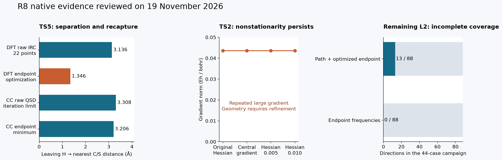
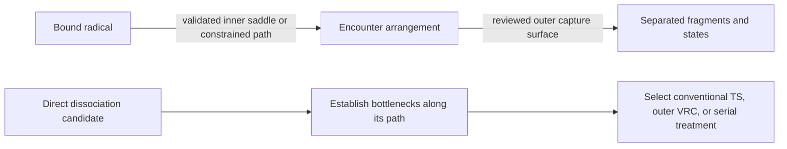

# R8 evidence review and requirements for R9

**Decision on 19 November 2026: R9 is not ready for a scientifically accepted launch.** **Necessity revision: no CC retry or duplicate B2PLYP path is required to make the available B2PLYP connectivity judgments.** The completed native panel resolves several diagnostic questions, preserves useful thermochemistry, and exposes unresolved connectivity, scope and rate-model issues. MESS remains paused. The following verdicts replace earlier statements that job completion, an orbital selection, or the lean scouting percentages established readiness.

## Evidence and coverage

| Evidence | Verified scope |
|---|---|
| Latest export | `examples/anl/tmp/validation-evidence_nov19.tar.gz`; 97,337,964 bytes; SHA256 `e3cbefcd55ce9bf01d5e9dc67f59b98e47281fb2bfa5dd5b4c9681903de6a8ac` |
| Extraction | 3,223 members; safe paths and ordinary files/directories; no duplicate members |
| Execution artifacts | 548 captured artifact hashes match; zero mismatches; 61 referenced artifacts omitted by the collection format: 48 checkpoints and 13 native directories |
| Native panel | 245 task records: 97 complete, 98 failed, 48 blocked, 2 staged. These are task/attempt records, not counts of distinct reactions |
| Separate remaining L2 campaign | 44 cases; 13 of 88 directions have path and optimized-endpoint database records; 75 directions have no such records; none of those 13 endpoints has frequency validation in the export |
| Full scouting network | 105 connections: CH3S 5 PST + 5 RRHO/union; CH3SS 42 PST + 53 RRHO/union |
| L1 energy-exclusion audit | All 24 recorded decisions inspected: 14 have usable L2 energies; 10 have unresolved saddle refinements |

The archive has no embedded source manifest. Its checksum identifies the received snapshot; execution receipts independently verify captured output files. The native panel's `completion.json` explicitly says `native_attempts_finished_review_required`, with scientific approval false. The separate `remaining_l2/controller.json` still says running and its exported owner log is empty. The user's subsequent `squeue` and matching-process checks returned no output, superseding that stale operational receipt.

Local raw evidence is under `local_runs/r8_validation_review_20261119/evidence/`. Below, `native/...` and `remaining_l2/...` are relative to that directory. Compact, reviewable data are in [review_20261119](../examples/anl/ch3ss_anl1_f12/recovery/r8_validation_20261114/review_20261119/). The full [task inventory](../examples/anl/ch3ss_anl1_f12/recovery/r8_validation_20261114/review_20261119/task_inventory.tsv) and [network inventory](../examples/anl/ch3ss_anl1_f12/recovery/r8_validation_20261114/review_20261119/full_network_inventory.tsv) retain the individual identities.

## Paper connections and current verdicts

Paper labels: **W4 = CH3SS; W2 = CH2SSH; W3 = HSCH2S; W1 = CH2S···SH.** These differ from KinBot's numbered `w_` labels. The comparison uses the supplied SI for Veillet et al., DOI 10.1039/D4CP04873C, the earlier direct-L2 export and the new native calculations.

The earlier direct-L2 source (SHA256 `2af5e4050709a976e21d6b483dcd621b65de482fcd67629f00e16301c02548b1`) already records converged Sella paths in both directions and positive endpoint frequencies for the cases below. Their compact receipts are in [prior_l2_connectivity.json](../examples/anl/ch3ss_anl1_f12/recovery/r8_validation_20261114/review_20261119/prior_l2_connectivity.json). A later unsuccessful redundant Gaussian integration does not erase that evidence. B2PLYP connectivity, independent integrator confirmation, and connectivity on a CC potential are distinct claims.

| Paper connection | B2PLYP evidence and present judgment | Additional work necessary for that judgment |
|---|---|---|
| TS1: W1 ↔ HCS + H2S | Sella paths converge in 241/156 steps; both endpoint spectra are positive. The expected abstraction connection is supported | None. Stop independent Gaussian retries and CC W1/path work for this connectivity decision |
| TS2: W2 ↔ W1 | Paper-seeded B2PLYP search instead gives W2 arrangements (158/119 steps, positive spectra). Native `54_1` gives W2 ↔ complex A (158/50 steps). The nominal paper-seeded saddle is not the expected B2PLYP connection; a native B2PLYP route supplies that connectivity | None to report this B2PLYP result. CC optimization/frequencies would answer a separate method-specific question |
| TS3: W3 ↔ W1 | Paper-seeded B2PLYP search gives W2 ↔ complex B (208/91 steps, positive spectra). The paper W3 connection was not recovered by this search | None to report non-recovery at B2PLYP. The missing W3 inner route is a separate R9 model decision, not justification to keep repairing CC |
| TS4: W4 ↔ W2 | Sella paths converge in 149/129 steps with positive endpoint spectra; native `2_1` supplies the same connection | None. Reuse one mapped representative; no duplicate Gaussian/CC path required |
| TS5: W3 → HC(=S)SH + H | B2PLYP parent-side evidence reaches W3; two native Gaussian product-side paths show H departure followed by recapture in unconstrained optimization. An inner H-loss saddle is supported; the recaptured minimum is not the separated product reference | None to reject a barrierless-only representation. The matched isolated HC(=S)SH + H threshold is 60.080360 kcal/mol relative to W4; B2PLYP TS5 is 64.916106 in the same harmonic-ZPE convention. Reuse these records; no CC path retry |
| TS6: W2 ↔ W3 | Paper-like B2PLYP path converges in 142/117 steps. Compact `12_1` also connects W2/W3 (131/129). Paper-like CC stationary-point evidence is additionally available | None for B2PLYP connectivity. Preserve distinct mapped saddles; stop failed compact-CC refinement retries |
| Lower native `12_2` | Earlier Sella paths converge in 146/107 steps with positive endpoint spectra and connect W2 ↔ complex B. Latest independent Gaussian attempts remain short or point-limited | Correct its B2PLYP assignment now; remove it from the W2–W3 barrier competition. No extra departure trial required solely for this reassignment |
| CH2SH H loss | `scale_1p6` connects CH2SH ↔ CH2S···H (80/123 steps); `scale_1p9` duplicates the result | Reuse the inner saddle; no new CC or duplicate IRC for its existence |
| Other changed native assignments | CH3S `1_2` and `3_1` connect loose CH2S···H arrangements; CH3SS `2_2` connects W2 ↔ CH2···HSS | Correct the model identities from existing B2PLYP evidence; do not preserve old labels as reaction assignments |

TS2/TS3 provide **method-specific non-reproduction of the nominal paper-seeded connections**, not proof that the paper's CC surface is wrong or that a missing physical route cannot exist. CC failure does not make the available B2PLYP judgment unavailable. The unsuccessful CC geometries and energies remain unusable; no replacement is needed unless a retained quantitative comparison specifically depends on them.

### Native findings that change the interpretation

| Finding | Quantitative evidence | Consequence |
|---|---|---|
| TS2 is not stationary | Gradient norms: original 0.043580; independent central gradient 0.043571; new Hessians 0.043560 and 0.043575 Eh/bohr | Reject this CC geometry. No further CC refinement or curvature job is required for the B2PLYP decision |
| TS2 negative modes persist | 0.005 step: 406.22i, 400.92i, 240.38i, 166.84i, 30.88i; 0.010: 406.41i, 402.75i, 245.87i, 168.61i, 32.56i cm⁻¹ | Reproducible negative curvature at a nonstationary geometry does not identify a fifth-order stationary point |
| TS3 failure moved downstream | Quadratic probe reaches ROHF energy −834.644856129650 Eh; CC subsequently reports its iteration limit and skips triples | Earlier `ROHF_not_converged` diagnosis is stale. Preserve the evidence; do not retry CC solely to clear the failure |
| `12_2` departure remains bounded | Forward DVV: 64 points, accumulated coordinate 1.16844; native `Maximum number of steps reached`; no minimum detected | This trial does not validate an independent Gaussian connection. Use the earlier complete Sella evidence for the B2PLYP assignment |
| Other one-point paths | `12_2` original paths: one point each; positive-time DVV: one point each. Native `2_2` half-step paths: one point each | These particular trials do not validate independent IRCs. The earlier Sella records remain separate reusable evidence |
| TS5 recapture | Gaussian raw 22-point path: departing H–C 3.136 Å; after optimization, H–S 1.346 Å. The 44-point half-step path reproduces separation and recapture | Retain raw-path and optimized geometries separately |
| TS5 CC forward is not a converged QSD connection | `forward.out:1195`: no convergence in maximum iterations; preceding internal path equations report nonconvergence. H–C reaches 3.308 Å | Directional evidence only, despite task status complete |
| TS5 following CC minimum is a loose complex | 12 positive modes, lowest 63.05 cm⁻¹; gradient norm 4.8261×10⁻⁵; departing H is at least 3.206 Å from C/S | Useful encounter geometry; it is not the infinite-separation product reference. CC reverse path failed ROHF and its endpoint task is blocked |

Exact sources include `native/cc_si_TS2_curvature_v1_electronic_v2/tasks/hessian_{005,010}/hessian_{005,010}.out:844`, `native/cc_si_TS3_curvature_v1_electronic_v2_quadratic_v3/tasks/electronic/electronic.out:553`, and `native/irc_native_ch3ss_rxn_12_2/tasks/forward_10_dvv_v1_positive_dt_v2_departure_v3/forward_10_dvv_v1_positive_dt_v2_departure_v3.log:33662`. Distances and atom maps are retained in [path_geometry_checks.json](../examples/anl/ch3ss_anl1_f12/recovery/r8_validation_20261114/review_20261119/path_geometry_checks.json).

## Inner reactions and outer capture must have separate evidence

The required model distinction is:

A reaction-family label, disconnected optimized endpoint, or unsuccessful saddle search cannot establish a barrierless path. Replacing a PST surface with a multireference VRC surface does not by itself repair a missing inner barrier. Serial bottlenecks and genuinely distinct parallel channels must remain distinguishable; a direct capture edge must not silently bypass a resolved inner reaction.

The following table covers all 16 PST entries in the historical lean/broader candidate map. Labels are from the **2 November map**; source identities in [scope_map.json](../validation/r9_scouting_scope/scope_map.json) are the binding keys. Later full-input labels differ.

| PES / old labels | Connection | Required treatment decision |
|---|---|---|
| CH3S `nobar_1` | CH3S → CH3 + S | Existing CAS(5,4) review can be reused for its exact dissociation/state model; verify sampled path and asymptotic conventions |
| CH3S `nobar_4` | CH2SH → CH2S + H | B2PLYP inner H-loss saddle and two-sided path exist (`scale_1p6`, with `1p9` duplicate evidence). Retain that inner barrier; assess only the outer treatment still needed |
| CH3SS `nobar_1` | CH3SS → CH3 + triplet S2 | Existing CAS(7,5) evidence; retain correct S2 state and exact C–S channel binding |
| CH3SS `nobar_2` | CH3SS → CH2SS + H | Direct H-loss saddle searches remain unresolved. Failed searches and failed product-side seeds do not justify barrierless assignment |
| CH3SS `nobar_3` | CH3SS → CH3S + S | Existing CAS(7,5) S–S subspace is distinct from the C–S subspace; bind exact state/path assets |
| CH3SS `nobar_4,24` | Two CH2SSH configurations → triplet CH2 + HSS | Preserve configuration/atom mapping; reconcile donor-space controls and inner versus outer path coverage |
| CH3SS `nobar_6,26` | Two CH2SSH configurations → CH2SH + S | Reconcile CAS(5,4)/CAS(7,5) historical selections using saved controls; establish any inner bottleneck |
| CH3SS `nobar_13` | HSCH2S → CH2S + SH | Paper-seeded TS3 does not supply this B2PLYP connection. Four B2PLYP scans now address the missing W3/encounter and direct CH3SS H-loss branches; outer CAS approval does not fill an inner-path gap |
| CH3SS `nobar_15` | HSCH2S → HC(=S)SH + H | Preserve the B2PLYP TS5 inner H-loss saddle; reuse the now native-verified isolated HC(=S)SH and H threshold |
| CH3SS `nobar_23,29,31` | Three CH(SH)2 configurations → HC(=S)SH + H | Each exact configuration needs an inner-bottleneck decision. Common fragments do not license a shared barrierless surface |
| CH3SS `nobar_39` | CH2S···SH → CH2S + SH | Outer-exit candidate; bind the exact encounter arrangement and outer-domain orbital evidence |
| CH3SS `nobar_42` | HCS···H2S → HCS + H2S | Outer-exit candidate; reuse the reviewed HCS π/SOMO/π* space with exact endpoint/state mapping |

The complete 105-edge ledger also includes the other 31 PST entries outside this historical shortlist. It records all their native labels, endpoint identities, source reactions where present, and current representations. Their scientific bottleneck binding remains open; being omitted from a previous lean shortlist does not close it. The latest full input includes direct H losses from additional side wells, mirror-copied surfaces, and outer exits with no `hom_sci` source tag. Those entries must be explicitly excluded with a valid bound or validated if retained.

CH2S···SH arrangements A and B must remain separate until a defensible population/transition mapping is established. Common fragment IDs do not demonstrate that they are one well. The prior proper-map geometry comparison found approximately 0.9 Å RMSD between the arrangements.

## Thermochemistry that can be reused

The following independently recomputed values use **ROHF-UCCSD(T*)-F12b T/Q single points on DZ-F12 geometries plus each point's DZ harmonic ZPE**, relative to W4. They are not CBS values. The supplied SI uses its own thermochemical/rotor convention, so the columns compare nearby models rather than an exact protocol reproduction.

| Point | SI relative energy | TZ + DZ ZPE | QZ + DZ ZPE | Proper-map SI geometry RMSD, Å |
|---|---:|---:|---:|---:|
| W4 | 0.000 | 0.000 | 0.000 | 0.025 |
| W2 | 24.564 | 24.468 | 24.510 | 0.042 |
| W3 | 20.197 | 20.871 | 21.091 | 0.045 |
| TS5 | 64.643 | 64.196 | 64.629 | 0.020 |
| TS6 | 61.220 | 59.933 | 60.098 | 0.002 |

Energies are kcal/mol. W2/W3/W4 have no imaginary modes; TS5 has 955.56i and TS6 856.40i cm⁻¹. These valid stationary-point results should be retained. Similar relative energies do not independently validate the connecting paths. Exact energies, ZPEs and permutations are in [cc_comparison.json](../examples/anl/ch3ss_anl1_f12/recovery/r8_validation_20261114/review_20261119/cc_comparison.json).

Compact native `12_1` has T/Q T1 diagnostics approximately 0.0543/0.0513 and D1 0.228/0.215; its attempted refinement reached T1 0.0803 and D1 0.343 before failure. These distinguish its reliability problem from the paper-like TS6 calculation. Do not use unconverged energies, `NOCHECK`, or `IGNORE_ERROR` to complete an accepted correction. The W1 refinement and TS1-forward QZ output end without enough native termination evidence to determine their final failure mechanism; their incomplete tails do not establish an out-of-memory or CC-iteration diagnosis.

### B2PLYP thresholds recovered without additional QC

Seven existing well/fragment records were independently matched against their
native Gaussian inputs and outputs: theory, charge, multiplicity, correlated
energy, harmonic ZPE, frequencies, normal termination and geometry. The largest
pair-distance discrepancy is below 0.000001 Å. Hashes and exact sources are in
[reused_fragment_verification.json](../examples/anl/ch3ss_anl1_f12/recovery/r8_validation_20261114/review_20261119/reused_fragment_verification.json).

| Point or separated threshold | B2PLYP + unscaled harmonic ZPE, kcal/mol relative to W4 |
|---|---:|
| W3 | 21.022629 |
| HC(=S)SH singlet + H doublet | 60.080360 |
| Paper-like TS5 | 64.916106 |
| CH2SS singlet + H doublet | 73.003054 |
| CH2S singlet + SH doublet | 43.875989 |

TS5 is 4.835746 kcal/mol above its separated products in this explicitly
spin-free harmonic convention. No new fragment energy is needed for that
comparison. Quantitative comparison with the paper still requires its stated
rotor/ZPE and spin conventions; the two conventions are not silently combined.

### A new inconsistency inside the supplied paper SI

The local `CH2S+SH/MESS_input.txt` has SHA256 `2c21c3f6905d07ad652a6b56be8f91284ae44154fb890b60d237326d7cbf0863`.

| SI barrier | W1-side depth from stated TS and W1 energies | Recorded Eckart depth | Difference |
|---|---:|---:|---:|
| TS1 | 12.250830 | 9.250830 | −3.000000 kcal/mol |
| TS3 | 4.596688 | 1.596688 | −3.000000 kcal/mol |

W1 `ZeroEnergy` is −6.2572387956 kcal/mol (line 166); TS1 and TS3 energies are 5.9935913428 and −1.6605510441 (lines 335 and 402). Their depth entries are at lines 340 and 407. The opposite-side depths are consistent. Both depths for TS4 and TS5 are also consistent. An unpropagated 3 kcal/mol W1 adjustment is a possible explanation, not an established account of the authors' intent.

Paper reproduction must distinguish **literal SI input** from an **energy-consistent Eckart variant**, preserving both provenances. Do not silently fix the SI or assign a kinetic disagreement to electronic structure before resolving this model difference. Arithmetic for every SI Eckart block is in [paper_si_checks.json](../examples/anl/ch3ss_anl1_f12/recovery/r8_validation_20261114/review_20261119/paper_si_checks.json).

## What the remaining L2 campaign actually contains

| Case | Captured directions | Geometry-level endpoint interpretation |
|---|---|---|
| CH3S `4_1`, `4_2` | F and R for each | CH2SH ↔ a C–S arrangement with one C-bound and two S-bound H atoms |
| CH3S `6_1` | F and R | CH2SH ↔ HSC···H2; the H is attached to S in the HSC fragment |
| CH3S `6_2` | F and R | CH2SH ↔ HCSH···H geometry |
| CH3S `6_3` | F and R | Two HCSH···H arrangements; both endpoints need frequency/state checks |
| CH3S `10_1` | F and R | HCSH···H ↔ the one-C-H/two-S-H arrangement |
| CH3SS `1_1` | F only | CH2S(H)S geometry with H on the C-bound sulfur; R remains unrecorded |
| Other 37 cases | Neither direction recorded | Workflow coverage remains open |

These descriptions report atom attachments, not inferred bond orders or independently established electronic localization. Close matches to prior CH2SH geometries are at 0.00003–0.00016 Å RMSD. New endpoint structures require their own identity and frequency validation. Distances, complete coordinates and database row IDs are in [remaining_l2_database_audit.json](../examples/anl/ch3ss_anl1_f12/recovery/r8_validation_20261114/review_20261119/remaining_l2_database_audit.json).

Endpoint minimization runs inside the parent IRC allocation. Absence of a separate `_prod.exitcode` is therefore not evidence of failure. The 13 captured paths have successful parent receipts and optimized-endpoint database rows, while saved recheck summaries remain stale. Preserve and adopt those results. Submission admission can wait inside the sequential controller loop, but the export does not prove the reason it stopped. The user subsequently confirmed no queued work or matching owner. A replay on a copy of the captured `ch3ss_rxn_1_1` case, with the actual QC status reader, adopts F and requests exactly R. Its retained H-migration saddle is 70.730 kcal/mol above W4; resolving that one missing connection is admitted. The other 43 cases are not restarted.

## Reassessment of the 24 energy exclusions

At B2PLYP-D3(BJ)/cc-pVTZ with harmonic ZPE and the preserved L2 parent references:

- Seven successful saddle refinements and seven product-threshold decisions remain above 150 kcal/mol.
- Their L2 values span **151.24–170.98 kcal/mol**. The 151.24 case is `791871710370000000002_r12_insertion_R_4_2_3`; it is not a robust exclusion throughout the earlier 140–155 kcal/mol sensitivity interval.
- Ten saddle refinements fail the negative-curvature requirement. Their old L1 exclusions remain unresolved at L2.
- The seven successful Hessians do not establish seven correct reaction connections: their independent paths fail, including one raw path followed by a `FormBX` endpoint-optimization failure.

All 24 old values, new values, identities, cutoff comparisons and native sources are in [screening_energy_audit.json](../examples/anl/ch3ss_anl1_f12/recovery/r8_validation_20261114/review_20261119/screening_energy_audit.json). Atomic fragment ZPE is zero; molecular double-hybrid totals use the correlated energy, not `SCF Done` alone. L1/L2 mixing would invalidate this comparison.

## Network and kinetics red flags

| Issue | Evidence and consequence | Required closure |
|---|---|---|
| Lean pruning is based on a superseded model | `local_runs/r8_pruning_20261113/STATUS.json` says native `hot_v1` predates the mirror-saddle correction; later MESS runs are false. The disputed low W2/W3 route and direct dissociation models also affect competition | Recompute scope sensitivity only after topology, counting and accepted energy inputs are fixed |
| `beta_off` is an incomplete test of this issue | `prepare_models.py` removes only CH2SH→CH2S+H and CH3SS→CH2SS+H; it retains the questioned HSCH2S→CH2S+SH edge | Use an explicit list of every changed inner/outer pathway; the scenario name is not coverage evidence |
| Labels drift between assembled models | Old `nobar_13` HSCH2S exit becomes `nobar_14`; other well/product/outer-exit labels also change | Bind source-input hash, full identities, atom maps and exact reaction source; never transfer by a bare label |
| A rate-model floor can hide a topology defect | MESS assembly can raise a submerged threshold to the connected-well floor and omit incompatible Eckart tunneling. Earlier `rxn_37` moved from approximately 41.67 to 42.34 kcal/mol | Review original QC threshold and serialized threshold separately; a floor is a numerical representation, not a validated saddle |
| Encounter-well identity and depth are provisional | The earlier unresolved entrance used an L1 binding depth of 5.4924 kcal/mol anchored to L2 fragments; arrangement A/B and other encounter populations have different geometries | Record each substitution and test its consequence in the corrected model; do not merge by fragment set alone |
| Mirror, optical, rotor and path factors interact | The later audit distinguishes true mirror rediscoveries from distinct parallel saddles. The retained optical approximation is a declared heuristic | Trace each factor once through exact endpoints and unstable-mode mapping; preserve distinct paths and avoid rotor/optical duplication |
| Legacy ChemID collisions affect thresholds | Earlier H–C–S–S versus S–C–S–H fragment partition correction changed H2-product thresholds from the colliding assignment to 82.28 versus 43.71 kcal/mol | Keep geometry/state identities attached to every energy source and imported fragment |
| The hot-parent model is not an experimental energy distribution | 148.142 kcal/mol was assigned as the full 193 nm photon energy to the modeled radical | State the actual parent preparation/energy partition; distinguish chemically activated yields, HPL branching and finite-pressure coefficients |
| Finite-pressure numerical issues remain | Earlier native tables contain 43 CH3S and 305 CH3SS negative coefficients, undefined reductions and low-temperature inconsistencies | Validate the observable used for each comparison; successful executable completion cannot certify these coefficients |
| Thermochemical conventions differ | Harmonic versus rotor/anharmonic ZPE, electronic spin-free versus term-resolved asymptotes, T/Q versus CBS, and triples scaling change barriers | Freeze one explicit energy ledger and record every conversion once |

Independent arithmetic on the latest preserved full scouting inputs found no scalar Eckart-depth discrepancy larger than 0.03 kcal/mol when their declared Eckart reference metadata are used. This checks serialization consistency only; it does not validate the energy sources or PST bottlenecks. The SI inconsistency above is separate.

## Multireference and spin treatment

Reuse the existing human-selected spaces and native review assets after exact channel binding. The November 12 outer CH2S+SH review supports CAS(5,4), two equally weighted doublet support roots and one reactive ground-parent doublet path. That result is specific to its outer domain. Other saved controls show materially different near-parent behavior: the small H-loss space has roughly 1.94–1.97 kcal/mol near-region discrepancies; the larger outer space can agree within about 0.234 kcal/mol outside while differing by 5.47–5.77 kcal/mol near the parent, with one return overlap around 0.723. Those controls preclude treating one outer-space success as a universal covalent-path validation.

For every retained multireference surface, the launch binding must contain: geometry/atom map, active electrons/orbitals, basis-specific WFU hash and record, selected roots, state-average weights, reactive-state weights, orbital continuity, reference asymptote, spin splitting and its energy zero. State-average support roots are not automatically additional reactive flux. Atomic S and molecular S2 term models must match fragment states used in the thermochemistry and kinetic degeneracies. Prior six-WFU checksum verification is reusable integrity evidence, not proof that all remapped channels share those orbitals.

The older scope document's statement that the final orbital export was missing is superseded by the later November 12 local export. Reuse that evidence before requesting more orbital calculations. The remaining issue is exact model/domain applicability, not starting the orbital review again.

## Recovery defect found and fixed

The second automatic Molpro CC iteration retry changed `;maxit,100` into `;maxit=200`. Molpro interpreted the latter as an illegal variable assignment and rejected `sp_paper_ts1_F/tz` during input checking. This was a generated-input defect, not additional chemical nonconvergence.

The shared [CC recovery procedure](../kinbot/anl/cc_iteration_recovery.py) now preserves the existing delimiter when raising a limit. A one-time repair requires matching native `MAXIT` input-error evidence and recorded retry history; it restores the comma at the same 200-iteration limit, archives the rejected attempt, retains the exhausted electronic retry history, and preserves unrelated live work. It changes neither theory nor convergence thresholds. No molecule or example identifier is used in installed code.

Local dispatcher tests cover the 100→200 sequence, archival, repeated invocation, exhausted retries, unrelated live work and rejection of mismatched evidence. Native success of the repaired retry on Blodgett remains unverified. The update and necessity-limited handoff are in [RECOVERY_HANDOFF.md](../examples/anl/ch3ss_anl1_f12/recovery/r8_validation_20261114/review_20261119/RECOVERY_HANDOFF.md).

## Necessity-limited closure sequence

The full [calculation decision ledger](../examples/anl/ch3ss_anl1_f12/recovery/r8_validation_20261114/review_20261119/CALCULATION_DECISIONS.md) supersedes the earlier broad CC/path closure recommendation.

| Order | Action | Calculation decision |
|---|---|---|
| 1 | Apply the B2PLYP paper/connectivity judgments above | Analysis and model mapping; zero new QC |
| 2 | Reconcile the 13 completed remaining-L2 directions and the current owner | Reuse captured results; empty live queue/process check supplied. Resume only `ch3ss_rxn_1_1` to obtain its missing R path |
| 3 | Bind each retained R9 edge to exact B2PLYP evidence | Reuse valid paths and matching endpoint spectra; select a missing direction/frequency only if that edge is retained and no equivalent valid evidence exists |
| 4 | Resolve retained direct W3 β-scission and CH3SS H-loss treatment | Four frozen B2PLYP scans: W3 outward, encounter A/B inward, W4 C–H outward. Review continuous maxima/branch switches before selecting any unconstrained saddle/path follow-up |
| 5 | Freeze the same-convention energy and paper SI ledgers | Reuse completed energies. Optional higher-level benchmarks remain optional; literal versus energy-consistent SI Eckart comparison requires no QC |
| 6 | Correct topology/counting/energy distribution, then reassess kinetics and scope | MESS remains paused; historical pruning percentages are not transferred to the changed model |
| 7 | Bind human-reviewed orbital assets and verify generated R9 inputs | Reuse exact channel/state/basis assets. Additional orbital work requires a demonstrated applicability gap |

**Current additional-QC admission: five initial allocations**, detailed in the
[calculation decision ledger](../examples/anl/ch3ss_anl1_f12/recovery/r8_validation_20261114/review_20261119/CALCULATION_DECISIONS.md)
and [tested launch handoff](../examples/anl/ch3ss_anl1_f12/recovery/r8_validation_20261114/review_20261119/RECOVERY_HANDOFF.md).
The old W3 C–S(H) L1 scan drops by about 0.0231 Eh immediately after its apparent
maximum. The new parent/encounter traces distinguish a smooth inner branch from
rearrangement. Direct W4 H loss has only unresolved L1/guessed-saddle evidence.
These gaps justify the four target-level scans; they do not justify repeating
accepted B2PLYP connections or optional CC diagnostics.

A scan is a constrained path, not an accepted transition state. A smooth maximum
on the intended branch must be refined and verified with one reaction-mode
imaginary frequency and two connections. A discontinuity is reviewed before
selecting another calculation. A monotonic finite trace must be joined to the
applicable outer domain before choosing a rate treatment. These follow-up inputs
depend on the new geometries and cannot be fixed from the current snapshot.

## Verification record and remaining access requirement

A separate verification pass, performed without additional agents, checked native termination/gradient/error lines against the derived verdicts; recomputed energies and SI well depths; compared raw and optimized coordinates; and opened the remaining-campaign SQLite databases read-only. It specifically caught the TS5 QSD iteration-limit message hidden by the complete task status. All 24 exclusion decisions and all 105 serialized network edges are enumerated, including unresolved entries.

The user has supplied an empty live Blodgett queue/process check. Native termination records for the truncated optional W1 and TS1-forward QZ attempts remain absent; their success is not required for the current B2PLYP judgments. The newly admitted scan/path jobs have local orchestration validation but have not yet been observed running natively. Scientific closure requires the model-relevant connections and decisions listed above; successful CC refinement of every diagnostic candidate is not a launch criterion. The audit is therefore a completed review of the supplied snapshot, with explicit open findings; it is not a claim that all chemical uncertainty has been eliminated or that R9 has passed its launch gates.
