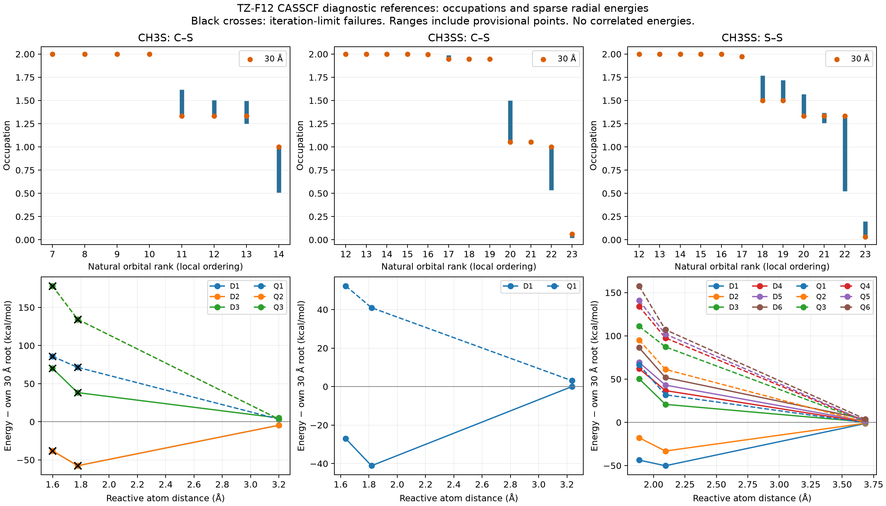

# Review of the completed CH3S/CH3SS reference-orbital campaign

Source: `ch3s_ch3ss_orbital_review_20261015.tar.gz`, exported on Blodgett at
08:25:04 on October 15. Archive SHA-256:
`33ab9f2441168a90b462957be929b7f863f76bfaa5d0621a9d086f8510e8b5b5`.
The analysis verified **423 file hashes**, all 81 native execution records,
the requested active counts, and the occupation electron sums. Binary WFU
files remain on Blodgett; their saved hashes cannot be reverified locally.

Reproduce the analysis from the repository root:

```bash
.venv/bin/python examples/anl/orbital_reviews/analyze.py \
    examples/anl/orbital_reviews/ch3s_ch3ss_orbital_review_20261015.tar.gz \
    examples/anl/orbital_reviews/results
```

The [machine-readable analysis](../examples/anl/orbital_reviews/results/summary.json)
contains native orbital tables, per-root truncation diagnostics, convergence
findings, timings and verified artifact hashes.



## Completion status correction

The old controller reported all 81 jobs complete. Native output inspection
finds **15 that need repair**:

- Seven CASSCF jobs (five panel jobs and two pilots, all CH3S) print
  `NO CONVERGENCE! MAXIMAL NUMBER OF ITERATIONS REACHED!`.
- Eight CASCI jobs (seven panel jobs and one pilot) used an RHF starting
  calculation that prints `?No convergence in rhfpr`.

The previous validator missed these strings and accepted the later normal
termination and energy markers. The corrected validator requires positive
MULTI convergence for CASSCF, rejects explicit iteration-limit failures, and
rejects RHF-based frozen CASCI comparisons after RHF failure. `report` also
checks convergence directly, preventing old manifest status from bypassing it.
The same explicit-failure protection now covers ANL Molpro extraction, the
ASE/ROTD sampling reader, VRC correction energies and the legacy PES energy
reader. The latter two also require normal completion before exposing a saved
energy. A later converged MULTI calculation can recover an HF starting guess
for multireference energies; it cannot recover a failed earlier MULTI step or
an unconverged displaced geometry in a force calculation.

Nine additional CASSCF calculations have an unconverged RHF initial guess but
**subsequently converge CASSCF**. Their optimized energies remain usable; the
RHF warning is retained and their RHF energies are not validated. Overall,
47 of 54 CASSCF executions converge, including all 36 CH3SS CASSCF executions.
The archive therefore contains 66 accepted probes and 15 rejected probes.

The seven CASSCF failures show nearly stationary energies and small gradients,
but are not relabeled as converged. The raw matched initialization difference
is at most 0.00004393 kcal/mol. Restricting to pairs where both optimizations
converged leaves 5 CH3S, 8 CH3SS C–S and 8 CH3SS S–S pairs; their root energies
agree to the eight decimal places stored in the manifest. This resolves the
large earlier CASCI initialization dependence at these tested geometries,
without proving behavior over every production sampling geometry.

## Candidate active spaces for user review

Numbers below are electrons/orbitals. Natural orbital numbers are local ranks
in this diagnostic output, not identities that may be transferred blindly.

| Channel | First candidate to validate | Chemical content | Larger comparison |
| --- | --- | --- | --- |
| CH3S → CH3 + S | CAS(5,4) | Methyl radical orbital and all three sulfur 3p orbitals; NO 11–14 at the 30 Å reference | CAS(9,6) and existing CAS(13,8) reference |
| CH3SS → CH3 + S2 | CAS(9,7) | Methyl radical plus the six sulfur 3p-derived bonding/antibonding orbitals; NO 17–23 at the separated reference | CAS(13,9), adding both sulfur 3s-derived orbitals, and existing CAS(19,12) reference |
| CH3SS → CH3S + S | CAS(9,7) | CH3S radical/lone-pair manifold, the free sulfur 3p shell, and the C–S bond/antibond partner; NO 17–23 | CAS(13,9) and existing CAS(19,12) reference |

For CH3S, the four additional occupied diagnostic orbitals have occupations
at least 1.98993 across the panel. Their character is predominantly C–H bonding
and sulfur 3s. At separation, the frontier occupations are 4/3, 4/3, 4/3 and 1.
Projecting the printed CI determinants onto a frozen CAS(5,4) excludes at most
0.3943% for D1, 1.0991% for D3 and 2.7440% for Q3; the largest case is the
tilted short-range probe. Unlike the old unoptimized result, there is no
near-total loss of the Q3 wavefunction in this projection. CAS(5,4) is a
credible small-space candidate, not a demonstrated correlated error bound.

For CH3SS C–S, S2 bonding occupations near 1.9458 and the antibonding
occupation 0.06127 persist at 30 Å. A CAS(3,3) containing just the three radical
orbitals omits printed determinant weight up to 7.6280%. This makes CAS(9,7)
the more conservative first trial for accuracy-preserving production.
For this same dissociation, [Veillet et al., section 3.3.2](https://pubs.rsc.org/en/content/articlehtml/2026/cp/d4cp04873c)
used CASPT2(11,8)/cc-pVDZ with a relaxed CASSCF scan and phase-space theory.
That is a useful comparison model, not evidence that identical orbital counts
alone guarantee the same space or VRC-TST accuracy.

For CH3SS S–S, the minimal asymptotic manifold is CAS(7,5): the two CH3S
radical/lone-pair components plus all three atomic sulfur p orbitals. But the
additional C–S bonding/antibonding pair is visible in the reference, and its
upper orbital reaches occupation 0.19818 at the compressed geometry. A fixed
CAS(7,5) loses up to 96.94% of the printed weight of a high, repulsive Q5 root
there. That does not invalidate a smaller outer-only model or prove that Q5
contributes to inner flux. It does argue against one untested CAS(7,5) for all
states and regions. The CAS(9,7) projection's largest excluded printed weight
is 0.3917%, in D5. Missing unprinted coefficients remain unknown.

These are squared printed determinant coefficients, not energy errors. The
proper test reoptimizes each candidate and compares correlated interaction
energies and spin gaps at consistent geometries and references.

## State averages, inner/outer treatment and cost

The current averages are diagnostics: CH3S has 3 doublets + 3 quartets;
CH3SS C–S has 1 + 1; CH3SS S–S has 6 + 6. At the same CH3SS parent geometry,
switching from the C–S average to the S–S average changes D1 by 1.92450 and Q1
by 1.79025 kcal/mol, and changes their gap by −0.13425 kcal/mol. Thus the
average must be part of the selected model, even for identical CAS counts.

CH3S's two lowest doublets and CH3SS S–S's two lowest doublets are attractive
at the sampled short-range radial points. This is a reason to test a reduced
inner average, not yet sufficient evidence to exclude every other surface
throughout the flux integral. The CH3SS C–S doublet is attractive at short
range and its sampled quartet is repulsive. The full fragment manifolds must
remain available for the outer-region assessment. This use of different
averages by region follows the motivation in the
[NH2O study, section 2.2](https://backend.orbit.dtu.dk/ws/portalfiles/portal/337661919/nh2_o_revised_final.pdf).

At 30 Å the CH3S spin-free root spread is 0.000151 kcal/mol. For CH3SS S–S,
the six doublets and six quartets form two nearly triply degenerate groups
separated by about 0.2086 kcal/mol. The frozen CH3S fragment geometry comes
from the CH3SS parent and is not an independently relaxed C3v fragment. This
splitting is not atomic spin–orbit data, and must not be inserted as such into
MESS. Fragment relaxation/state character needs checking for production.

Median CASSCF times on eight ranks were about 5.5 minutes for CH3S (including
stalled jobs), 7.8 minutes for CH3SS C–S and 8.7 minutes for CH3SS S–S. These
are reference optimizations; there are no CASPT2, MRCI or CCSD(T) timings in
this archive. No timing-based conclusion about production basis sets follows.
After repair and candidate choice, benchmark correlated methods at a few
shared geometries, first at TZ-F12, then DZ-F12 sampling and QZ-F12 correction
checks if useful. Compare relative interactions and spin gaps, not total
basis energies. Do not repeat a complete QZ reconnaissance campaign yet.

## Repair only the rejected probes

### Follow-up: complete CASSCF without blocking on optional CASCI controls

The initial repair passed both CH3S CASSCF pilots. Its CH3SS C–S CASCI pilot
at 30 Å then stalled in **RHF,SO**, reaching 100 iterations and printing
`NO CONVERGENCE! MAXIMAL NUMBER OF ITERATIONS REACHED!` before the MULTI
section. This differs from conventional RHF's `No convergence in rhfpr`
diagnostic. The recon validator now detects this earlier failure too; a later
frozen CASCI result and normal Molpro termination do not recover it. Shared
production checks also recognize Molpro's `Restricted Hartree-Fock` program
header when a subsequently converged CASSCF legitimately recovers the guess.

Stop the current controller and resume **only CASSCF** using the command below.
This retains/revalidates its two successful pilots and runs six pending panel
jobs at the reported stopping point. CASCI-only work is deferred, not approved.
The final status is `selected_complete_review_required`, with
`selected_probe_method: casscf`; CASCI systems show `selected: false` and may
remain incomplete. This is sufficient to continue optimized-reference review,
not to claim that the entire original comparison campaign passed.

At large separation, a low-spin coupling of a doublet radical and a triplet
fragment is intrinsically multiconfigurational. Molpro RHF requires its singly
occupied electrons to couple to high spin; a one-open-orbital doublet RHF is
not the neutral three-open-orbital asymptote. This is a reason to avoid making
that optional starting-reference control a production gate, not a proven
diagnosis of every stalled iteration. See the [Molpro SCF wavefunction rules](https://www.molpro.net/manual/doku.php?id=the_scf_program).
The optimized state-averaged CASSCF references and subsequent correlated
interaction-energy/spin-gap checks remain required. We are not loosening any
convergence thresholds or substituting unconverged CASCI energies.

### Solver repair and restart

The subsequent repair rejected
`02_recon/avt_f12__cs_orient_f1_bond_a60_r1p776838825` for both RHF and
CASSCF nonconvergence. Two other Slurm allocations were still running when
the controller exited. Their shortened names are insufficient to identify
the initialization; `squeue ... %Z` confirmed both are in `03_recon`.
The supplied native output confirms both iteration-limit failures despite
return code zero. RHF reached a gradient of about 4.4e-7 at iteration 100;
the CASSCF state-averaged energy remained -436.99904561 Eh at the displayed
precision through iterations 40–50, with small residuals. This suggests a
numerical stopping issue, but does not prove convergence or identify the
unmet criterion. Check the printed native thresholds and column headers
before choosing another solver change; normal termination and printed
energies do not supersede the convergence requirement. Molpro documents
separate [MCSCF energy and orbital-gradient criteria](https://www.molpro.net/manual/doku.php?id=the_mcscf_program_multi#convergence_thresholds).

Failure handling now stops new submissions but monitors already submitted
jobs until they leave the queue and their outputs validate or fail. This also
works when a restarted controller encounters a full-panel failure while
rechecking its pilots. `progress` displays `draining_after_failure`, then
`failed` with all observed failures; completed counterparts remain reusable.
The controller-only update below adopts any surviving allocations without
retrying the rejected calculation. It is a monitoring repair, not a claim that
the electronic convergence problem has been solved. Do not repeat the same
solver repair or relax convergence thresholds without inspecting the output.

**Scheduling follow-up:** all six repaired CASSCF panel jobs have no checkpoint
predecessor; the three checkpoint-initialized probes each have their own seed.
The previous one-at-a-time behavior came from sequential system controllers
and a redundant first-job check in each full panel, despite successful pilots.
Campaign scheduling now uses a shared queue and skips that redundant check
after the pilots pass. Up to six remaining jobs can therefore be active in
this repair, within the configured maximum of 20; the scheduler still decides
when requested resources are available.

To update a **running** convergence campaign without cancelling its Molpro
allocations, use this controller-only handoff on Blodgett. Completed outputs,
running job IDs and native inputs remain in place. No `retry-failed` call is
needed while adopting live allocations.

```bash
bash <<'BASH'
set -euo pipefail
cd /home/hram/KinBot
KB_PY=/home/hram/KinBot/.venv/bin/python
RUN=/home/hram/kinbot-runs/ch3s_ch3ss_orbital_convergence_20261015
env -u LD_LIBRARY_PATH -u LD_PRELOAD \
    git -c submodule.recurse=false pull --ff-only origin composite
"$KB_PY" -m pip install -e . --no-build-isolation --no-deps
"$KB_PY" -m kinbot.orbital_campaign stop-controller "$RUN"
export KINBOT_MOLPRO_SCRATCH=/home/hram/.cache/kinbot/molpro
export KINBOT_MOLPRO_SCRATCH_MIN_MB=65536
mkdir -p "$KINBOT_MOLPRO_SCRATCH"
nohup "$KB_PY" -u -m kinbot.orbital_campaign run "$RUN" \
    --probe-method casscf --max-jobs 20 --max-refinements 0 \
    >> "$RUN/controller.log" 2>&1 < /dev/null &
printf '%s\n' "$!" > "$RUN/controller.pid"
"$KB_PY" -m kinbot.orbital_campaign progress "$RUN"
tail -n 30 "$RUN/controller.log"
squeue -u hram -o '%.18i %.10T %.48j %.10M %Z'
BASH
```

If a submission was interrupted between `sbatch` and recording its returned
job ID, the controller stops for reconciliation rather than submitting a
duplicate. It also stops on a failed queue query. Its single writer holds all
participating manifest locks while counting slots and submitting new work.

The full stop/repair procedure below remains available for an intentionally
cancelled campaign or initial preparation.

`orbital_review repair-convergence OLD NEW` prepares a separate campaign from
the rejected native outputs. It preserves the old files and all valid work.
It uses quadratic RHF (`rhf,so`) and, for the small CASSCF reference, exact CI
diagonalization with L-BFGS disabled (`exact_diag=1,qn=0`). The basis, active
space, state weights and energy thresholds are unchanged. These solver
choices are documented in the [SCF](https://www.molpro.net/manual/doku.php?id=the_scf_program)
and [MULTI](https://www.molpro.net/manual/doku.php?id=the_mcscf_program_multi)
manuals; their convergence on these inputs still requires the native pilots.
Dense exact-CI repair is limited to references with at most eight orbitals.

The original supplied archive prepared 13 distinct system/anchor repairs plus
four native pilots. The CASSCF-only resume selects six of those panel jobs and
two pilots; it reuses any already completed selected jobs. One successful
full-panel anchor is repeated because its separate pilot had failed in the
original campaign. The original campaign's historical progress JSON is not
rewritten; native findings and replacement results supersede it.

On Blodgett:

```bash
bash <<'BASH'
set -euo pipefail
cd /home/hram/KinBot
KB_PY=/home/hram/KinBot/.venv/bin/python
OLD=/home/hram/kinbot-runs/ch3s_ch3ss_orbital_review_20261015
NEW=/home/hram/kinbot-runs/ch3s_ch3ss_orbital_convergence_20261015
env -u LD_LIBRARY_PATH -u LD_PRELOAD \
    git -c submodule.recurse=false pull --ff-only origin composite
"$KB_PY" -m pip install -e . --no-build-isolation --no-deps
"$KB_PY" -m kinbot.run_cleanup "$OLD" --stop --timeout 300
export KINBOT_MOLPRO_SCRATCH=/home/hram/.cache/kinbot/molpro
export KINBOT_MOLPRO_SCRATCH_MIN_MB=65536
mkdir -p "$KINBOT_MOLPRO_SCRATCH"
if [ -f "$NEW/campaign.json" ]; then
    "$KB_PY" -m kinbot.run_cleanup "$NEW" --stop --timeout 300
    "$KB_PY" -m kinbot.orbital_campaign retry-failed "$NEW" --include-interrupted
else
    "$KB_PY" -m kinbot.orbital_review repair-convergence "$OLD" "$NEW"
fi
"$KB_PY" -m kinbot.orbital_campaign preflight "$NEW"
nohup "$KB_PY" -u -m kinbot.orbital_campaign run "$NEW" \
    --probe-method casscf --max-jobs 20 --max-refinements 0 \
    >> "$NEW/controller.log" 2>&1 < /dev/null &
printf '%s\n' "$!" > "$NEW/controller.pid"
"$KB_PY" -m kinbot.orbital_campaign progress "$NEW"
tail -n 30 "$NEW/controller.log"
BASH
```

After completion, export on Blodgett:

```bash
bash <<'BASH'
set -euo pipefail
cd /home/hram/KinBot
KB_PY=/home/hram/KinBot/.venv/bin/python
RUN=/home/hram/kinbot-runs/ch3s_ch3ss_orbital_convergence_20261015
STAMP=$(date +%Y%m%d_%H%M%S)
"$KB_PY" -m kinbot.orbital_review report "$RUN" "$RUN/review_report_$STAMP.json"
"$KB_PY" -m kinbot.orbital_campaign collect "$RUN" \
    /home/hram/kinbot-runs/ch3s_ch3ss_orbital_convergence_20261015.tar.gz
BASH
```

Copy back from a local Mac terminal:

```bash
bash <<'BASH'
set -euo pipefail
cd /Users/hrishikeshram/KinBot
scp hram@blodgett.ca.sandia.gov:/home/hram/kinbot-runs/ch3s_ch3ss_orbital_convergence_20261015.tar.gz \
    examples/anl/orbital_reviews/
BASH
```

Both original and replacement archives are needed for review.
No final active space, physical surface model, or production input is selected
by this analysis or repair.
