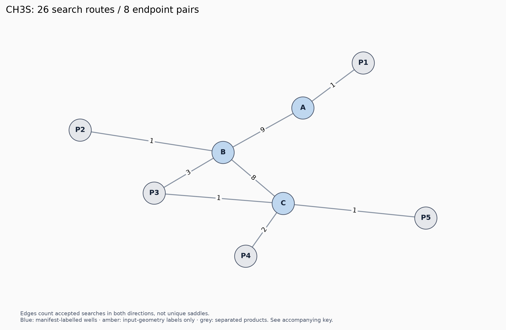
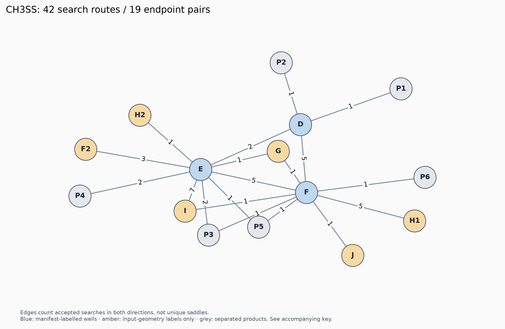

# Accepted search topology, 21 October 2026

Source: the user-pasted live monitor inventory. These are topology maps, not energy diagrams. Edge counts include reverse discoveries and multiple search templates; they do not establish independent saddles.

No current expanded energy table was supplied. No literature energies have been assigned to these nodes.

## CH3S

26 accepted search routes, 8 unordered endpoint pairs.

| Key | Label | Route | Evidence |
|---|---|---|---|
| A | `C[S]` | `470831050000000000002` | manifest |
| B | `C=[SH]` | `471030810040000000002` | manifest |
| C | `[CH]=[SH2]` | `471230610040000000002` | manifest |
| P1 | `[CH3] + [S]` | `150390060000000000002+320000000000000000003` | manifest |
| P2 | `[CH2] + [SH]` | `140260020000000000003+330330000000000000002` | manifest |
| P3 | `[H][H] + [C]#S` | `20020000000000000001+450770130000000000002` | manifest |
| P4 | `H + product 46090046…` | `10000000000000000002+460900460020000000001` | partial label |
| P5 | `Products 13013000… + 34066002…` | `130130000000000000002+340660020000000000001` | unmapped |

| Direction | Search routes |
|---|---|
| A → B | `intra_H_migration_2_3`, `r12_insertion_R_3_1_2`, `R_Addition_MultipleBond_2_1_3`, `12_shift_S_R_2_1_3` |
| A → P1 | `hom_sci_1_2` |
| B → A | `intra_H_migration_1_3`, `r12_insertion_R_3_2_1`, `R_Addition_MultipleBond_1_2_3`, `12_shift_S_F_1_2_3`, `h2_elim_3_5` |
| B → C | `intra_H_migration_2_4`, `intra_H_migration_2_5` |
| B → P3 | `r12_insertion_R_4_1_2`, `r12_insertion_R_4_1_5`, `r12_insertion_R_5_1_4` |
| B → P2 | `hom_sci_1_2` |
| C → B | `intra_H_migration_1_3`, `intra_H_migration_1_4`, `r12_insertion_R_1_2_4`, `R_Addition_MultipleBond_1_2_4`, `12_shift_S_F_1_2_3`, `12_shift_S_F_1_2_4` |
| C → P3 | `r12_insertion_R_5_1_2` |
| C → P4 | `R_Addition_MultipleBond_1_2_3`, `h2_elim_3_4` |
| C → P5 | `hom_sci_1_2` |

## CH3SS

42 accepted search routes, 19 unordered endpoint pairs.

| Key | Label | Route | Evidence |
|---|---|---|---|
| D | `CS[S]` | `791471490990000000002` | manifest |
| E | `C=S=[SH]` | `791671450790040000002` | manifest |
| F | `[S]S=C` | `791671580700000000002-s8fc26f5f496eeb4e` | manifest |
| F2 | `CH2–S(H)–S connectivity` | `791671580700000000002-s36f1e2b924862f12` | input geometry only |
| G | `H–S–C(H)–S–H connectivity` | `791671560700020000002-sedd8f7729b69b19b` | input geometry only |
| H1 | `CH–S(H)–S(H) connectivity` | `791871560500020000002-s1a4d7914034ddafc` | input geometry only |
| H2 | `CH–S(H)–S(H) connectivity` | `791871560500020000002-s254020c87a151164` | input geometry only |
| I | `HS–CH2–S connectivity` | `791472110370000000002` | input geometry only |
| J | `CH–S(H)2–S connectivity` | `791871710370000000002` | input geometry only |
| P1 | `[CH3] + [S][S]` | `150390060000000000002+640640000000000000003` | manifest |
| P2 | `[S] + C[S]` | `320000000000000000003+470831050000000000002` | manifest |
| P3 | `[CH2] + product 65097033…` | `140260020000000000003+650970330000000000002` | partial label |
| P4 | `H + product 78154110…` | `10000000000000000002+781541100460020000001` | partial label |
| P5 | `H2 + product 77121077…` | `20020000000000000001+771210770330000000002` | partial label |
| P6 | `[S] + C=[SH]` | `320000000000000000003+471030810040000000002` | manifest |

| Direction | Search routes |
|---|---|
| D → F | `intra_H_migration_2_4` |
| D → E | `intra_H_migration_3_4`, `r13_insertion_RSR_4_1_2_3` |
| D → P1 | `hom_sci_1_2` |
| D → P2 | `hom_sci_2_3` |
| E → G | `intra_H_migration_2_5` |
| E → H2 | `intra_H_migration_2_6` |
| E → F2 | `intra_H_migration_2_4`, `12_shift_S_F_2_3_4`, `12_shift_S_R_2_3_4` |
| E → I | `intra_R_migration_3_1`, `intra_R_migration_1_3`, `Intra_R_Add_ExoTetCyclic_F_1_3_4`, `R_Addition_MultipleBond_1_2_3`, `12_shift_S_F_3_2_1`, `12_shift_S_F_1_2_3`, `12_shift_S_R_3_2_1` |
| E → P3 | `r12_insertion_R_2_1_5`, `hom_sci_1_2` |
| E → F | `r12_insertion_R_3_2_1` |
| E → P4 | `r12_insertion_R_6_1_2`, `r12_insertion_R_6_1_5` |
| E → P5 | `h2_elim_5_6` |
| F → D | `intra_H_migration_1_4`, `r12_insertion_R_2_1_6`, `h2_elim_4_5`, `h2_elim_4_6` |
| F → J | `intra_H_migration_2_5` |
| F → H1 | `intra_H_migration_2_6`, `r12_insertion_R_6_1_2`, `r13_insertion_RSR_5_1_2_3`, `r13_insertion_RSR_6_1_2_3`, `h2_elim_5_6` |
| F → E | `intra_H_migration_3_4`, `r12_insertion_R_3_2_4`, `12_shift_S_F_3_2_4`, `12_shift_S_R_3_2_4` |
| F → I | `intra_R_migration_3_1` |
| F → G | `r12_insertion_R_5_1_2` |
| F → P5 | `r12_insertion_R_5_1_6` |
| F → P3 | `hom_sci_1_2` |
| F → P6 | `hom_sci_2_3` |

## Interpretation

CH3S has four reported local TS aliases and three PES-wide aliases; CH3SS has one local TS alias and zero PES-wide aliases in the supplied registry. Alias totals overlap and must not simply be subtracted from route counts. Zero live jobs selected for cancellation is not zero reuse.

CH3SS I has HS–CH2–S input connectivity, so a candidate for that constitutional well has been discovered. Its accepted reaction list is still empty. The inventory does not yet prove its final stationary-point identity, a connection to the paper’s specific conformer, or completion of exploration from it.

F/F2 and H1/H2 retain their distinct routing suffixes. Similar connectivity is not sufficient to collapse stereochemical states or conformers.

The current evidence cannot distinguish every pair of same-endpoint searches. Run the read-only PES audit to compare accepted L2 geometries, energies, frequencies, and pathway metadata before retiring expensive graphs.
